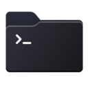
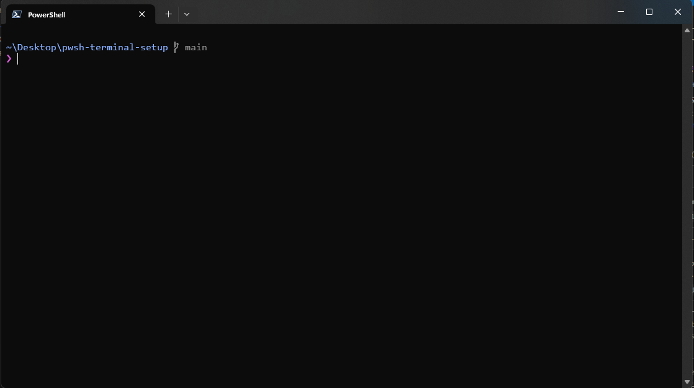
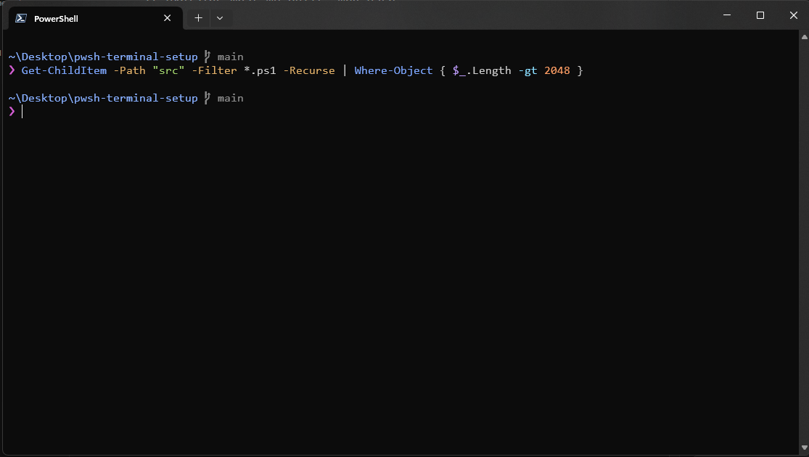
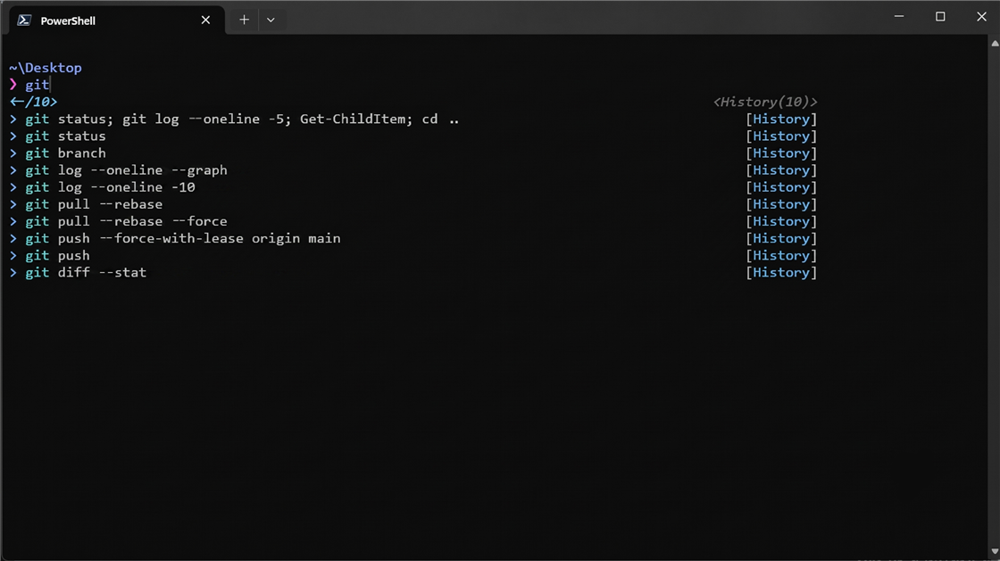
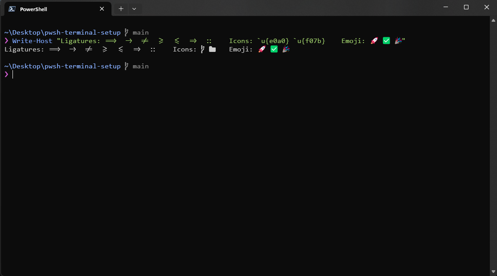

<p align="center">
  
</p>

<h1 align="center">pwsh-terminal-setup</h1>

<p align="center">
  <strong>A fast, good-looking PowerShell 7 + Windows Terminal setup, from a single command.</strong>
</p>

<p align="center">
  <a href="https://learn.microsoft.com/powershell/scripting/install/installing-powershell-on-windows"></a>
  <a href="https://aka.ms/terminal"></a>
  <a href="LICENSE"></a>
  <a href="https://github.com/Abdullah-Masood-05/pwsh-terminal-setup/releases"></a>
  <a href="https://abdullah-masood-05.github.io/pwsh-terminal-setup/"></a>
  <a href="https://github.com/Abdullah-Masood-05/pwsh-terminal-setup/stargazers"></a>
</p>

<p align="center">
  ⭐ <b>Enjoying pwsh-terminal-setup?</b> If it's useful to you, please <a href="https://github.com/Abdullah-Masood-05/pwsh-terminal-setup">star it on GitHub</a>. It's free and it helps other developers find it.
</p>

<p align="center">
  <a href="https://abdullah-masood-05.github.io/pwsh-terminal-setup/"><b>Documentation</b></a> ·
  <a href="https://github.com/Abdullah-Masood-05/pwsh-terminal-setup/releases"><b>Download</b></a> ·
  <a href="#install"><b>Install</b></a> ·
  <a href="https://abdullah-masood-05.github.io/pwsh-terminal-setup/docs/manual-setup/"><b>Manual setup</b></a>
</p>

---

> [!CAUTION]
> **Install PowerShell 7 first.** This setup needs PowerShell 7 (`pwsh`). The *Windows PowerShell 5.1*
> that comes with Windows is **not** enough. Check with `pwsh --version`; if it isn't recognized, run
> `winget install --id Microsoft.PowerShell --source winget`, reopen your terminal, then install.
> See [Requirements](https://abdullah-masood-05.github.io/pwsh-terminal-setup/docs/requirements/).

It cuts shell startup from seconds to milliseconds by lazy-loading conda, installs a font with
**both ligatures and Nerd Font icons**, adds a clean zsh-like prompt, and configures PSReadLine for
syntax highlighting, smart history, and proper word navigation, all from one script, or a bundled
installer with the font included.

> **Full documentation**, including screenshots, a step-by-step manual guide, the complete command
> reference, and troubleshooting, lives on the **[documentation website](https://abdullah-masood-05.github.io/pwsh-terminal-setup/)**.
> This README is the short version.

## Preview

<!-- Screenshots from Windows Terminal with LigaConsolas Nerd Font on a dark theme. -->

<table>
  <tr>
    <td width="50%"></td>
    <td width="50%"></td>
  </tr>
  <tr>
    <td><b>Minimal prompt</b>: path, conda env, and git branch (with branch glyph).</td>
    <td><b>Syntax highlighting</b>: commands, parameters, strings, numbers, operators.</td>
  </tr>
  <tr>
    <td></td>
    <td></td>
  </tr>
  <tr>
    <td><b>History predictions</b>: past commands suggested as a ListView dropdown.</td>
    <td><b>Ligatures + Nerd icons</b>: <code>==&gt;</code> <code>!=</code> <code>-&gt;</code> join; branch/folder glyphs render.</td>
  </tr>
</table>

## Features

- **Fast startup**: conda is loaded on first use instead of on every launch, taking startup from
  ~2.3 s to ~0.3 s. PowerShell telemetry and the update-check banner are disabled.
- **Ligatures + icons**: installs your pick of [LigaConsolas Nerd Font](https://github.com/Dosx001/ttf-ligaconsolas-nerd-font)
  (Consolas-style, the default) or [JetBrains Mono Nerd Font](https://github.com/ryanoasis/nerd-fonts),
  both with programming ligatures *and* Nerd Font glyphs, per-user, no admin.
- **Minimal zsh-like prompt**: path, active conda env, and git branch. The branch is read straight
  from `.git/HEAD`, so rendering the prompt never spawns `git` (instant, even in big repos).
- **Great editing**: PSReadLine with a dark syntax-highlighting palette, history-based predictions
  (ListView), prefix history search on ↑/↓, and `Ctrl+←/→` word jumps that actually work in Windows
  Terminal.

## Requirements

Install these **before** running the installer:

- Windows 10/11
- **[PowerShell 7+](https://learn.microsoft.com/powershell/scripting/install/installing-powershell-on-windows)** (not Windows PowerShell 5.1): `winget install --id Microsoft.PowerShell --source winget`
- [Windows Terminal](https://aka.ms/terminal): `winget install --id Microsoft.WindowsTerminal -e`

## Install

### Option A: Installer (recommended)

1. Download the latest **`pwsh-terminal-setup-x.y.z-Setup.exe`** from the
   [Releases](https://github.com/Abdullah-Masood-05/pwsh-terminal-setup/releases) page.
2. Run it and pick a font (LigaConsolas or JetBrains Mono). It installs per-user (no admin
   needed), **bundles both fonts so it works offline**, and applies the whole setup.

> The installer is unsigned, so Windows SmartScreen may warn on first launch. Click **More info →
> Run anyway**. PowerShell 7 must be installed first; if it isn't, the installer offers to install
> it with winget.

### Option B: Script

```powershell
git clone https://github.com/Abdullah-Masood-05/pwsh-terminal-setup.git
cd pwsh-terminal-setup
pwsh -ExecutionPolicy Bypass -File .\install.ps1
# or, with JetBrains Mono Nerd Font:
pwsh -ExecutionPolicy Bypass -File .\install.ps1 -Font JetBrainsMono
```

Then **restart Windows Terminal**, open a new PowerShell tab, and verify:

```powershell
Write-Host "Icons: `u{e0a0}  `u{f07b}   Ligatures: ==> -> != >= <=   Emoji: 🚀 ✅"
```

You should see the branch/folder icons, joined operators, and color emoji. Try `Ctrl+←` / `Ctrl+→`
to jump word-by-word.

## Customize from the command line

You don't have to hand-edit any file. The installer takes settings as parameters and applies them
in one run:

```powershell
# Font size, color scheme, prompt symbol, and prediction style in one shot
.\install.ps1 -FontSize 12 -ColorScheme "One Half Dark" -PromptSymbol "➜" -PredictionView InlineView

# Prompt + editing config only, skip conda and fonts
.\install.ps1 -SkipConda -SkipFont
```

| Parameter | What it changes |
|---|---|
| `-Font <LigaConsolas\|JetBrainsMono>` | Which bundled Nerd Font to install and apply |
| `-FontSize <n>` | Windows Terminal font size |
| `-ColorScheme <name>` | Windows Terminal color scheme (must already exist in `settings.json`) |
| `-Opacity <0-100>` | Window background opacity (enables acrylic below 100) |
| `-PromptSymbol <char>` | The prompt glyph (default `❯`) |
| `-PredictionView <ListView\|InlineView>` | PSReadLine prediction style |
| `-FontFamily <name>` | Font family used in Windows Terminal |
| `-SkipFont` / `-SkipTerminal` / `-SkipProfile` / `-SkipConda` | Skip a step |
| `-Uninstall` | Remove the setup's profile regions and Windows Terminal font face |

See the full **[installer options reference](https://abdullah-masood-05.github.io/pwsh-terminal-setup/docs/installer-options/)** in the docs.

## What it installs

| Step | Action | Safety |
|------|--------|--------|
| 1 | Sets `POWERSHELL_TELEMETRY_OPTOUT` and `POWERSHELL_UPDATECHECK` at **User** scope | env vars only |
| 2 | Installs LigaConsolas or JetBrains Mono Nerd Font (per-user, registered in HKCU) | no admin |
| 3 | Writes the profile to `$PROFILE.CurrentUserAllHosts` | backs up to `profile.ps1.bak` once; merges idempotently |
| 4 | Sets the font on Windows Terminal `profiles.defaults` and frees `Ctrl+←/→` | backs up `settings.json.bak` once; JSON validated |
| 5 | Measures startup and confirms conda is a lazy placeholder | n/a |

Everything is **idempotent** (safe to re-run) and **portable** (paths resolved dynamically; conda is
auto-detected across anaconda3 / miniconda3 / miniforge3 / PATH).

## Prefer to configure it by hand?

The **[manual setup guide](https://abdullah-masood-05.github.io/pwsh-terminal-setup/docs/manual-setup/)**
walks through every step (installing PowerShell 7, **downloading and installing the Nerd Font**,
adding the profile, and patching Windows Terminal) with copy-able commands. The profile
([`profile.ps1`](profile.ps1)) and the Windows Terminal fragments
([`windows-terminal/settings.partial.jsonc`](windows-terminal/settings.partial.jsonc)) are readable
on their own.

## Uninstall / restore

Uninstall from **Settings → Apps** (if you used the `.exe`), or run:

```powershell
.\install.ps1 -Uninstall
```

That strips the setup's regions from your profile (your own lines stay) and removes its font face
from Windows Terminal. For a full revert, restore the backups. The `.bak` is written on the first
install and kept on re-runs, so it is always your original:

```powershell
Copy-Item "$($PROFILE.CurrentUserAllHosts).bak" $PROFILE.CurrentUserAllHosts -Force
# and restore settings.json from its .bak next to the original
```

## Credits

- Fonts: [Dosx001/ttf-ligaconsolas-nerd-font](https://github.com/Dosx001/ttf-ligaconsolas-nerd-font) and
  [JetBrains Mono](https://github.com/JetBrains/JetBrainsMono) via [Nerd Fonts](https://github.com/ryanoasis/nerd-fonts) (OFL-1.1)
- Prompt style inspired by [Pure](https://github.com/sindresorhus/pure); palette by
  [Tokyo Night](https://github.com/folke/tokyonight.nvim).

## License

[MIT](LICENSE)
